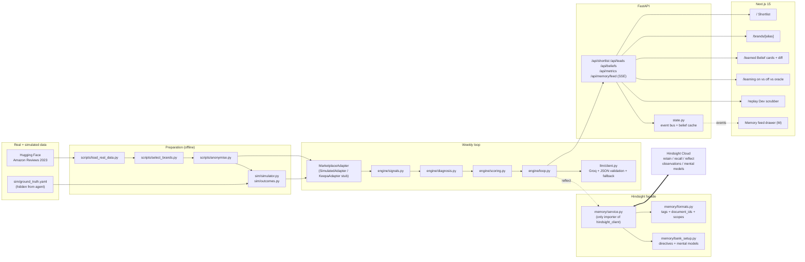

# Architecture

Underdog is a small FastAPI + Next.js app. The interesting parts are the deterministic
signal/diagnosis pipeline (numbers) and the Hindsight facade (memory). Everything else
is glue.

## Invariants

- `grep -R "hindsight_client" backend/app/` -> only `memory/service.py`.
- `grep -R "ground_truth" backend/app/` -> only `backend/app/eval/oracle.py`.
- Every `retain*` call carries a stable `document_id` and the simulated `timestamp`.
- Every `recall` carries `query_timestamp = sim_date`.
- Every `reflect` prompt starts with `"Today is {sim_date} (week {week} of the season)."` because `reflect` has no `query_timestamp` parameter.
- Every retain item passes an explicit non-empty `observation_scopes` list-of-lists.
- No em dashes in generated content, docs, or the frontend.
- No real brand names anywhere — everything goes through `brand_alias.csv` (gitignored).

## Numbers -> memory -> words

- **Numbers** (signals, diagnosis rules, base score, angle mapping) live in Python and are unit-tested. The LLM never emits a number the app relies on.
- **Memory** (every snapshot, pitch, outcome, and the beliefs they consolidate into) lives in Hindsight. Directives and mental models are set once at bank setup.
- **Words** (email drafts, per-lead reasons, belief summaries) come from Groq with JSON-mode + Pydantic validation + one repair retry + a deterministic template fallback. The demo cannot crash because of the LLM.
